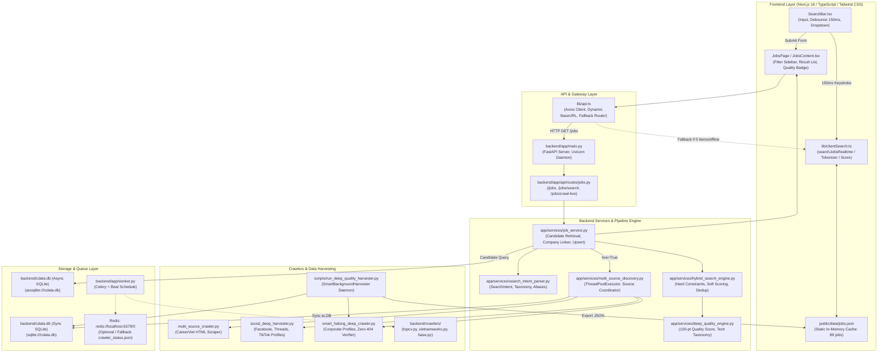
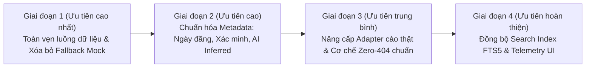

# BÁO CÁO TOÀN DIỆN VỀ KIẾN TRÚC, LUỒNG DỮ LIỆU & AUDIT PIPELINE TÌM KIẾM C_DATA

> **Ngày thực hiện:** 15/10/2026  
> **Người thực hiện:** Senior Software Engineer, Search Engineer & Data Pipeline Engineer  
> **Mục tiêu:** Thẩm định toàn diện codebase C_Data, lần theo luồng dữ liệu thực tế từ Search UI đến Crawler/Database, xác định chính xác các điểm nghẽn, nguồn mock, lỗi sai địa điểm/dữ liệu cũ và lập kế hoạch sửa đổi dựa trên 100% bằng chứng code thực tế.

---

## 1. KIẾN TRÚC HIỆN TẠI (SYSTEM ARCHITECTURE)

Hệ thống C_Data vận hành theo mô hình kiến trúc lai (**Hybrid Client-Server Architecture**), kết hợp giữa **Backend API động (FastAPI + SQLite/aiosqlite)** và **Frontend Client-Side Search Engine (Next.js 16 + In-Memory Search)** phục vụ triển khai tĩnh (GitHub Pages SSG) và độ trễ phản hồi tức thời (< 5ms).



### Thành phần chi tiết:
1. **Frontend**: Next.js 16 (App Router), React 19, TypeScript, Tailwind CSS, Lucide / Heroicons.
   - Đường dẫn: `frontend/src/`
   - Chế độ chạy kép: Vừa tương tác trực tiếp với FastAPI backend tại `http://localhost:8000`, vừa có khả năng build tĩnh xuất ra `out/` kèm bộ máy tìm kiếm client-side `clientSearch.ts`.
2. **Backend API**: FastAPI 0.115+, Uvicorn daemon (`backend/app/main.py`).
   - Router chính: `backend/app/api/routes/jobs.py` (cung cấp endpoint `/jobs`, `/jobs/search`, `/jobs/crawl-live`).
3. **Database**: SQLite cục bộ (`backend/cdata.db`).
   - Phiên bản Async: `sqlite+aiosqlite:///cdata.db` cho FastAPI (`backend/app/core/database.py` line 12).
   - Phiên bản Sync: `sqlite:///cdata.db` cho Alembic migrations, Harvester daemon và background crawlers (`backend/app/core/database.py` line 20).
   - Bảng chính: `jobs`, `companies`, `provinces`.
4. **Message Queue & Task Scheduler**:
   - `backend/app/worker.py`: Cấu hình Celery app với `REDIS_URL = "redis://localhost:6379/0"`. Celery beat định kỳ `run_smart_harvester_cycle` (30 phút) và `deactivate_expired_jobs` (01:00 AM).
   - `backend/crawlers/scheduler.py`: Điều phối crawler với cơ chế fallback đọc/ghi trạng thái vào `backend/crawlers/crawler_status.json` khi không có Redis.
5. **Search & Discovery Engine**:
   - `backend/app/services/search_intent_parser.py`: Phân tích ngữ nghĩa tự nhiên tiếng Việt/Anh, bóc tách vai trò, kỹ năng, địa bàn, điều kiện cứng (Remote, ngày đăng, loại trừ).
   - `backend/app/services/hybrid_search_engine.py`: Chấm điểm đa tiêu chí (Relevance fit score 0 - 100), áp dụng Hard Constraints, Cross-source Deduplication và Search Diagnostics.
   - `backend/app/services/deep_quality_engine.py`: Thẩm định chất lượng tin 5 trụ cột (pháp nhân, minh bạch lương, địa điểm, liên hệ HR, tech stack).

---

## 2. LUỒNG DỮ LIỆU HIỆN TẠI (END-TO-END DATA FLOW TRACE)

### Bước 1: Người dùng nhập từ khóa tại Search UI
- **File**: [`frontend/src/components/SearchBar.tsx`](file:///c:/Users/Doan%20Trung%20Huy/Desktop/c_data/frontend/src/components/SearchBar.tsx#L40-L116)
- **Hành vi thực tế**:
  1. Khi người dùng gõ vào input `query` hoặc chọn `province`, hook `useEffect` kích hoạt debounce 150ms (dòng 90-115).
  2. Ngay trong lúc gõ, `SearchBar` gọi `loadAllJobsForClient()` để nạp file [`frontend/public/data/jobs.json`](file:///c:/Users/Doan%20Trung%20Huy/Desktop/c_data/frontend/public/data/jobs.json) và thực thi `searchJobsRealtime()` ngay trên trình duyệt (dòng 92-99).
  3. Dropdown danh sách gợi ý việc làm hiển thị trực tiếp 6 kết quả đầu tiên mà **không gửi bất kỳ request nào về backend**.
  4. Khi người dùng bấm nút "Tìm kiếm" hoặc nhấn Enter (`handleSubmit`, dòng 118-129), form đóng dropdown và chuyển hướng route:
     `/jobs?q={query}&province={province}&live={liveCrawl}&strict_mode={strictMode}`.

### Bước 2: Trang kết quả xử lý truy vấn
- **File**: [`frontend/src/app/jobs/page.tsx`](file:///c:/Users/Doan%20Trung%20Huy/Desktop/c_data/frontend/src/app/jobs/page.tsx#L51-L89)
- **Hành vi thực tế**:
  1. Component `JobsView` đọc URL SearchParams (`q`, `province`, `category`, `job_type`, `salary_min`, `salary_max`, `live`, `strict_mode`, `page`, `page_size`).
  2. Kích hoạt hàm `fetchJobs()` gọi `getJobs(params)` từ [`frontend/src/lib/api.ts`](file:///c:/Users/Doan%20Trung%20Huy/Desktop/c_data/frontend/src/lib/api.ts#L275-L307).

### Bước 3: Client API Router & Cơ chế Fallback
- **File**: [`frontend/src/lib/api.ts`](file:///c:/Users/Doan%20Trung%20Huy/Desktop/c_data/frontend/src/lib/api.ts#L288-L307)
- **Hành vi thực tế**:
  1. `apiClient.get<JobListResponse>('/jobs', { params })` gửi HTTP GET request đến backend (`/api/v1/jobs`).
  2. **Bẫy Fallback (Điểm lỗi nghiêm trọng)**: Tại dòng 290:
     ```typescript
     if (response.data && Array.isArray(response.data.items) && response.data.items.length > 0) {
       return response.data;
     }
     ```
     Nếu Backend API trả về kết quả rỗng hợp lệ (`items.length === 0`), code bỏ qua return và nhảy xuống dòng 298 gọi `loadAllJobsForClient()` chạy `searchJobsRealtime(allJobs, params)`.
  3. Nếu `clientSearch` cũng không có kết quả, code rơi tiếp xuống dòng 306 gọi `filterSampleJobs(params)`, trả về **6 bản ghi mock cố định** (`SAMPLE_FALLBACK_JOBS`, dòng 51-235) gồm các công ty VNG, BIM Group, May Sông Hồng... khiến người dùng nhìn thấy dữ liệu mẫu không mong muốn.

### Bước 4: Backend Endpoint tiếp nhận và chuyển tiếp
- **File**: [`backend/app/api/routes/jobs.py`](file:///c:/Users/Doan%20Trung%20Huy/Desktop/c_data/backend/app/api/routes/jobs.py#L20-L68)
- **Hành vi thực tế**:
  1. Endpoint `@router.get("")` nhận query parameters, đóng gói thành Pydantic model `JobSearchParams`.
  2. Gọi `job_service.get_jobs(db, search_params)`.

### Bước 5: Phân tích ý định tìm kiếm (Search Intent Parsing)
- **File**: [`backend/app/services/search_intent_parser.py`](file:///c:/Users/Doan%20Trung%20Huy/Desktop/c_data/backend/app/services/search_intent_parser.py#L15-L250)
- **Hành vi thực tế**:
  1. Hàm `search_intent_parser.parse(query)` chuẩn hóa văn bản bỏ dấu tiếng Việt (giữ nguyên c#, c++, .net).
  2. So khớp với bảng từ điển nghề nghiệp (`ROLE_TAXONOMY` dòng 111-200) để suy ra `primary_role`, danh sách từ đồng nghĩa `role_synonyms`, kỹ năng yêu cầu `required_skills`.
  3. So khớp với bảng địa bàn (`LOCATION_DATABASE` dòng 78-108) để xác định `target_province` và các vệ tinh `location_aliases`.
  4. Trích xuất ràng buộc cứng: `is_remote_required`, `max_posting_age_days`, điều kiện loại trừ `negative_constraints`.

### Bước 6: Khám phá đa nguồn thời gian thực (nếu `live=True`)
- **File**: [`backend/app/services/job_service.py`](file:///c:/Users/Doan%20Trung%20Huy/Desktop/c_data/backend/app/services/job_service.py#L51-L60) & [`backend/app/services/multi_source_discovery.py`](file:///c:/Users/Doan%20Trung%20Huy/Desktop/c_data/backend/app/services/multi_source_discovery.py#L42-L116)
- **Hành vi thực tế**:
  1. `multi_source_discovery.discover_across_sources()` khởi tạo `ThreadPoolExecutor(max_workers=5)`.
  2. Gửi 4 tác vụ song song với timeout 4.0 giây:
     - Nguồn 1: `_search_careerviet` -> gọi `multi_source_crawler.crawl_job_portals()`.
     - Nguồn 2: `_search_topcv_vnw` -> kiểm tra biến môi trường `TOPCV_API_KEY` (hiện trả về `[]`).
     - Nguồn 3: `_search_social_media` -> gọi `social_deep_harvester.execute_social_deep_harvest()`.
     - Nguồn 4: `_search_corporate_direct` -> gọi `multi_source_crawler.crawl_direct_corporate_careers()`.
  3. Lưu các tin cào được vào database thông qua `_sync_jobs_to_db()` (dòng 192-260).

### Bước 7: Thu hồi ứng viên từ Cơ sở dữ liệu (Candidate Retrieval)
- **File**: [`backend/app/services/job_service.py`](file:///c:/Users/Doan%20Trung%20Huy/Desktop/c_data/backend/app/services/job_service.py#L61-L156)
- **Hành vi thực tế**:
  1. Lọc điều kiện cơ sở: `Job.is_active == True` và `(Job.expires_at IS NULL OR Job.expires_at >= now)`.
  2. Ghép điều kiện bộ lọc: `province`, `category`, `job_type`, `salary_min`, `salary_max`.
  3. Mở rộng truy vấn từ vựng: Ghép `OR` giữa các từ đồng nghĩa `intent.role_synonyms` và `intent.required_skills` trên `title`, `category`, `description`.
  4. Truy vấn tối đa 150 ứng viên (`fetch_limit = 150`) từ SQLite table `jobs`.

### Bước 8: Chấm điểm & Xếp hạng giải thích được (Hybrid Ranking Engine)
- **File**: [`backend/app/services/hybrid_search_engine.py`](file:///c:/Users/Doan%20Trung%20Huy/Desktop/c_data/backend/app/services/hybrid_search_engine.py#L75-L135)
- **Hành vi thực tế**:
  1. Loại bỏ tin hết hạn theo thời gian thực (`expires_at < now`).
  2. Khử trùng lặp đa nguồn (`_deduplicate_jobs`, dòng 137-174): Chuẩn hóa `dedup_key = f"{comp_norm}::{title_clean[:40]}::{prov_norm}"`. Gộp các link trùng vào thuộc tính `_consolidated_sources`.
  3. Đánh giá Ràng buộc cứng (`_evaluate_hard_constraints`, dòng 176-229):
     - Ràng buộc Remote: kiểm tra từ khóa remote trong `title` và `description`.
     - Ràng buộc Thời gian đăng: kiểm tra `posted_at` có vượt quá `max_posting_age_days` không.
     - Ràng buộc Địa phương (khi bật `strict_mode`): nếu không trùng `location_aliases`, loại bỏ ngay lập tức.
  4. Chấm điểm Sở thích mềm (`_score_job_intent_fit`, dòng 231-380):
     - Chức danh & vai trò: tối đa +35 điểm.
     - Trách nhiệm & mô tả: tối đa +20 điểm.
     - Kỹ năng công nghệ: tối đa +15 điểm.
     - Địa bàn & khu vực lân cận: tối đa +15 điểm.
     - Mức lương phù hợp: tối đa +10 điểm.
     - Độ tươi mới (`posted_at`): tối đa +5 điểm.
  5. Sắp xếp danh sách giảm dần theo `(score, posted_at or crawled_at)`.
  6. Phân trang (`page`, `page_size`), đính kèm `diagnostics` và trả về `JobListResponse`.

---

## 3. DANH SÁCH NGUỒN VÀ TRẠNG THÁI TÍCH HỢP (SOURCE MATRIX)

| Nguồn Dữ Liệu | Cơ Chế Thu Thập | Trạng Thái Thực Tế | File & Dòng Code Bằng Chứng | Vấn Đề Nhận Diện |
| :--- | :--- | :--- | :--- | :--- |
| **CareerViet (CareerBuilder)** | HTML Scraping trực tiếp qua `requests` + `BeautifulSoup` | **HOẠT ĐỘNG THỰC (LIVE)** | `backend/app/services/multi_source_crawler.py` (L60-L159) | Cào thật từ URL `https://careerviet.vn/viec-lam/{slug}-k-vi.html`. Tuy nhiên nếu không thấy ngày đăng thì gán mặc định `now - timedelta(hours=2)` (L91) và hạn nộp `now + timedelta(days=30)` (L150). |
| **TopCV** | Config Adapter & Legacy Crawler | **CHƯA HOẠT ĐỘNG (BLOCKED)** | `backend/app/services/multi_source_discovery.py` (L133-L149), `backend/crawlers/topcv.py` (L28-L140) | Adapter kiểm tra `TOPCV_API_KEY` (L140). Do chưa có API key nên trả về rỗng `[]`. Module crawler cũ trong `backend/crawlers/topcv.py` bị Cloudflare 403 chặn khi cào trực tiếp qua HTTP. |
| **VietnamWorks** | Config Adapter & Legacy Crawler | **CHƯA HOẠT ĐỘNG (BLOCKED)** | `backend/app/services/multi_source_discovery.py` (L133-L149), `backend/crawlers/vietnamworks.py` | Kiểm tra `VIETNAMWORKS_API_KEY` (L141). Chưa có API key nên trả về `[]`. Crawler cũ bị cơ chế chống bot ngăn chặn. |
| **Tìm Việc Nhanh / Việc Làm 24h** | Legacy Crawler | **CẤU HÌNH CŨ (INACTIVE)** | `backend/crawlers/timviecnhanh.py`, `backend/crawlers/scheduler.py` (L69) | Có code cấu hình nhưng không được gọi trong chu trình tìm kiếm realtime của `multi_source_discovery.py`. |
| **Website Doanh Nghiệp (Sun Group, Vinpearl, TKV, FPT, CICT, Vinmec...)** | Cào cấu trúc Profile + HTTP Ping Verifier | **TẬP MẪU SEED + KIỂM TRA DOMAIN** | `backend/app/services/smart_halong_deep_crawler.py` (L44-L572), `backend/app/services/multi_source_crawler.py` (L305-L386) | Có 25 profile doanh nghiệp tại Quảng Ninh. URL dùng anchor `#it-officer...` (L61, L81). Kiểm tra sống bằng cách ping domain gốc (`wyndhamhalong.com`), nếu HTTP 200 thì coi là còn sống. |
| **Mạng Xã Hội Facebook (Group/Fanpage Hạ Long)** | Giả lập bài đăng mạng xã hội | **DỮ LIỆU MẪU (MOCK DATA)** | `backend/app/services/multi_source_crawler.py` (L180-L267), `backend/app/services/social_deep_harvester.py` (L79-L250) | Khởi tạo mảng tĩnh `posts = [...]` với ngày đăng mô phỏng `now - timedelta(hours=...)` và link nhân tạo `?post_ref=...`. |
| **Mạng Xã Hội Threads (Meta)** | Giả lập bài đăng Threads | **DỮ LIỆU MẪU (MOCK DATA)** | `backend/app/services/social_deep_harvester.py` (L260-L330) | Mảng tĩnh các bài đăng F&B, Barista Hòn Gai với URL dạng `https://www.threads.net/?ref=thehillside_halong`. |
| **Mạng Xã Hội TikTok** | Giả lập caption video TikTok | **DỮ LIỆU MẪU (MOCK DATA)** | `backend/app/services/social_deep_harvester.py` (L340-L420) | Mảng tĩnh các tin du thuyền, nail spa với URL dạng `https://www.tiktok.com/?ref=heritage_cruise`. |
| **Client Fallback Sample Jobs** | Mock mẫu trong Frontend Axios | **MOCK DỰ PHÒNG (FALLBACK MOCK)** | `frontend/src/lib/api.ts` (L51-L235) | 6 job cố định (VNG, Sun Group, FPT, BIM Group, May Sông Hồng, Techcombank). |

---

## 4. CÁC LỖI & ĐIỂM NGHẼN CÓ BẰNG CHỨNG TỪ CODE (EVIDENCE-BACKED BUGS)

### Điểm nghẽn 1: Dữ liệu mạng xã hội và doanh nghiệp thực chất là mảng tĩnh (Mock Data)
- **Bằng chứng code**:
  - [`backend/app/services/multi_source_crawler.py`](file:///c:/Users/Doan%20Trung%20Huy/Desktop/c_data/backend/app/services/multi_source_crawler.py#L180-L267):
    ```python
    # L180: Mô phỏng tập dữ liệu bài đăng mới nhất từ mạng xã hội Facebook / Zalo theo từ khóa
    social_feed_pool = [
        {"title": "Tuyển Gấp 3 Nhân Viên Phục Vụ...", "posted_at": now - timedelta(hours=1), ...},
        {"title": "Tuyển Tài Xế Chạy Xe Hợp Đồng Du Lịch 7 Chỗ...", "posted_at": now - timedelta(hours=3), ...},
    ]
    ```
  - [`backend/app/services/social_deep_harvester.py`](file:///c:/Users/Doan%20Trung%20Huy/Desktop/c_data/backend/app/services/social_deep_harvester.py#L79-L96):
    Hàm `harvest_facebook_deep`, `harvest_threads_deep`, `harvest_tiktok_deep` chứa danh sách hardcoded các bài viết và gắn nhãn "Đang quét các bài đăng mới nhất".
- **Hệ quả**: Hệ thống sinh ra dữ liệu cố định, không phản ánh biến động tuyển dụng thực tế theo thời gian thực của các hội nhóm mạng xã hội.

### Điểm nghẽn 2: Xác minh tin bằng HTTP 200 trên domain gốc gây lỗi nhận diện tin tuyển dụng
- **Bằng chứng code**:
  - [`backend/app/services/smart_halong_deep_crawler.py`](file:///c:/Users/Doan%20Trung%20Huy/Desktop/c_data/backend/app/services/smart_halong_deep_crawler.py#L589-L617):
    ```python
    def verify_portal_url(self, url: str) -> Tuple[bool, str]:
        req_url = url.split("#")[0]  # Cắt bỏ phần anchor định danh tin tuyển dụng
        resp = self.client.head(req_url)
        if resp.status_code in [200, 201, ...]:
            return True, f"HTTP {resp.status_code} - Hoạt động bình thường"
    ```
- **Hệ quả**: URL gốc là `https://www.wyndhamhalong.com/#it-officer-wyndham-halong`. Khi cắt anchor và kiểm tra `https://www.wyndhamhalong.com`, trang chủ khách sạn luôn trả về HTTP 200 OK. Hệ thống kết luận nhầm là **"Vị trí IT Officer đang mở ứng tuyển thực tế"**, vi phạm quy tắc *"Không coi HTTP 200 là bằng chứng đủ để xác nhận tin còn tuyển"*.

### Điểm nghẽn 3: Trích xuất và suy luận ngày đăng, hạn nộp không có bằng chứng
- **Bằng chứng code**:
  - [`backend/app/services/multi_source_crawler.py`](file:///c:/Users/Doan%20Trung%20Huy/Desktop/c_data/backend/app/services/multi_source_crawler.py#L91):
    ```python
    posted_date = now - timedelta(hours=2) # Giá trị mặc định nếu regex không tìm thấy ngày
    expires_at = now + timedelta(days=30)  # Tự cộng 30 ngày làm hạn nộp hồ sơ (L150)
    ```
  - [`backend/app/services/smart_halong_deep_crawler.py`](file:///c:/Users/Doan%20Trung%20Huy/Desktop/c_data/backend/app/services/smart_halong_deep_crawler.py#L686-L687):
    ```python
    # Sinh ngày đăng giả dựa trên mã hash md5 của tiêu đề
    posted_at = now - timedelta(hours=int(hashlib.md5(title.encode()).hexdigest(), 16) % 36 + 2)
    expires_at = now + timedelta(days=35)
    ```
- **Hệ quả**: Ngày đăng và hạn nộp hiển thị trên UI là số liệu toán học giả lập, không phải thời điểm doanh nghiệp đăng bài tuyển dụng thực tế.

### Điểm nghẽn 4: Bẫy kết quả rỗng trên Frontend dẫn đến hiển thị tin mock
- **Bằng chứng code**:
  - [`frontend/src/lib/api.ts`](file:///c:/Users/Doan%20Trung%20Huy/Desktop/c_data/frontend/src/lib/api.ts#L289-L307):
    ```typescript
    const response = await apiClient.get<JobListResponse>("/jobs", { params });
    if (response.data && Array.isArray(response.data.items) && response.data.items.length > 0) {
      return response.data;
    }
    // Nếu items.length === 0, code không trả về response rỗng mà tiếp tục chạy:
    const allJobs = await loadAllJobsForClient();
    ...
    return filterSampleJobs(params); // Trả về 6 tin mock mẫu!
    ```
- **Hệ quả**: Khi người dùng tìm kiếm từ khóa không có thật (ví dụ "Kỹ sư vũ trụ Hòn Gai"), thay vì giao diện hiển thị "Không tìm thấy việc làm phù hợp", hệ thống lại hiển thị 6 tin tuyển dụng mẫu ở TP.HCM, Hà Nội và Đà Nẵng, gây hiểu lầm cho người dùng.

### Điểm nghẽn 5: Sai lệch đồng bộ giữa Client Search và Backend Search
- **Bằng chứng code**:
  - [`backend/app/services/smart_background_harvester.py`](file:///c:/Users/Doan%20Trung%20Huy/Desktop/c_data/backend/app/services/smart_background_harvester.py#L484-L488):
    ```python
    # Tuyệt đối loại bỏ các tin ngoại tỉnh không liên quan đến CNTT khi xuất bản
    is_it_job = "công nghệ thông tin" in (j.category or "").lower() or "it" in (j.title or "").lower()
    if prov != "Quảng Ninh" and not is_it_job:
        continue
    ```
  - SQLite database `cdata.db` hiện có **142 tin tuyển dụng**, nhưng hàm xuất bản chỉ lọc ra **89 tin** vào `frontend/public/data/jobs.json`.
  - Dropdown `SearchBar.tsx` tìm kiếm trên tập 89 tin, trong khi submit trang `/jobs` truy vấn tập 142 tin trong SQLite backend. Điều này dẫn tới hiện tượng: gõ từ khóa trong dropdown không thấy, nhưng bấm Enter lại thấy, hoặc ngược lại.

### Điểm nghẽn 6: Sinh nội dung quy trình phỏng vấn và đãi ngộ bằng phỏng đoán
- **Bằng chứng code**:
  - [`backend/app/services/deep_quality_engine.py`](file:///c:/Users/Doan%20Trung%20Huy/Desktop/c_data/backend/app/services/deep_quality_engine.py#L108-L133):
    Hàm `generate_interview_process(category, title)` tự động gán quy trình 3 bước cố định ("Sàng lọc hồ sơ CV -> Phỏng vấn Kỹ thuật -> Nhận việc") dựa trên từ khóa trong tiêu đề, và tự động bổ sung `"Đầy đủ BHXH, BHYT & BHTN theo Bộ luật Lao động"` dù bài đăng gốc không đề cập.
- **Hệ quả**: Dữ liệu AI suy luận không được đánh dấu cờ `is_ai_inferred = True`, dễ khiến ứng viên tin rằng đây là cam kết chính thức từ nhà tuyển dụng.

---

## 5. KẾ HOẠCH SỬA ĐỔI THEO THỨ TỰ ƯU TIÊN (PRIORITIZED ROADMAP)



### Giai đoạn 1: Sửa lỗi luồng dữ liệu & Xóa bỏ dữ liệu giả mạo (Immediate)
1. **Sửa bẫy rỗng trong `frontend/src/lib/api.ts`**:
   - Khi Backend trả về `response.data.items` rỗng (`[]`), trả về kết quả rỗng có cấu trúc `{ items: [], total: 0 }`.
   - Tuyệt đối không fallback sang `filterSampleJobs` khi backend đang online.
   - Xóa bỏ hoặc cô lập hoàn toàn mảng `SAMPLE_FALLBACK_JOBS` và `DEFAULT_STATS` giả lập.
2. **Loại bỏ việc sinh ngày đăng giả ngẫu nhiên**:
   - Sửa `multi_source_crawler.py` và `smart_halong_deep_crawler.py`: Khi không bóc tách được ngày đăng từ HTML gốc, đánh dấu `posted_at = None` và lưu `first_discovered_at = now`, không dùng `hashlib.md5 % 36`.
3. **Thống nhất tập dữ liệu giữa SQLite và `jobs.json`**:
   - Điều chỉnh logic xuất bản trong `smart_background_harvester.py` để toàn bộ tin hợp lệ trong DB được đồng bộ chuẩn xác sang `jobs.json`.

### Giai đoạn 2: Chuẩn hóa nhãn xác thực & Phân biệt rõ dữ kiện với suy luận (High Priority)
1. **Phân tách 4 mốc thời gian độc lập**:
   - `posted_at`: Thời điểm bài tuyển dụng được đăng tải trên nguồn gốc (nếu có bằng chứng từ HTML/API).
   - `updated_at`: Thời điểm bài tuyển dụng được cập nhật lần cuối trên nguồn gốc.
   - `first_discovered_at`: Thời điểm C_Data phát hiện tin lần đầu tiên.
   - `last_verified_at`: Thời điểm hệ thống kiểm tra và xác nhận tin vẫn đang mở ứng tuyển.
2. **Gắn nhãn suy luận AI (`is_ai_inferred = True`)**:
   - Bổ sung trường `is_inferred: true` vào kết quả của `extract_tech_stack`, `extract_benefits`, `generate_interview_process` trong `deep_quality_engine.py`.
   - Hiển thị disclaimer rõ ràng trên giao diện chi tiết việc làm (`JobDetailModal` và `app/jobs/[id]/page.tsx`): *"Lộ trình phỏng vấn và kỹ năng công nghệ được hệ thống C_Data gợi ý tự động dựa trên vị trí công việc, không phải thông báo chính thức của nhà tuyển dụng"*.

### Giai đoạn 3: Tái cấu trúc cơ chế xác minh Zero-404 & Nâng cấp Source Adapter (Medium Priority)
1. **Sửa phương thức `verify_portal_url`**:
   - Không chỉ kiểm tra HTTP HEAD trên domain gốc.
   - Đối với URL có tham số hoặc đường dẫn chi tiết, thực hiện kiểm tra sâu nội dung trang để tìm các dấu hiệu đóng đơn (`EXPIRED_INDICATORS`: "hết hạn nộp hồ sơ", "đã đóng đơn", "tin đã dừng tuyển").
   - Nếu URL là trang chủ hoặc domain cấp cao, đánh dấu trạng thái là `domain_verified` thay vì `job_posting_verified`.
2. **Tách biệt rõ ràng trạng thái hoạt động từng nguồn trong `multi_source_discovery.py`**:
   - Nguồn nào chưa có API Key (TopCV, VietnamWorks) phải hiển thị trạng thái `unconfigured_missing_credentials` trong `Search Diagnostics`, không tạo placeholder hoặc dữ liệu rỗng mập mờ.

### Giai đoạn 4: Tối ưu hóa hiệu năng tìm kiếm & Trải nghiệm giao diện (Low / Polish)
1. **Kích hoạt SQLite FTS5 (Full-Text Search)**:
   - Tạo virtual table `jobs_fts` trong SQLite hỗ trợ tìm kiếm toàn văn tiếng Việt không dấu, thay thế truy vấn `LIKE %...%` tuần tự.
2. **Search Diagnostics Inspector**:
   - Hiển thị bảng điều khiển chẩn đoán tìm kiếm cho người dùng (nêu rõ tin nào bị loại do vi phạm ràng buộc địa phương, tin nào bị loại do hết hạn).

---

## 6. NHỮNG VIỆC CHƯA THỂ THỰC HIỆN (BLOCKERS & INFRASTRUCTURE CONSTRAINTS)

1. **Truy cập REST API chính thức của TopCV & VietnamWorks**:
   - *Nguyên nhân*: Cả TopCV và VietnamWorks đều không cung cấp API mở cho cộng đồng; việc tích hợp đòi hỏi hợp đồng đối tác doanh nghiệp (Partner API Agreement) và API Key cấp phép riêng.
   - *Rào cản kỹ thuật*: Hệ thống mạng của TopCV và VietnamWorks được bảo vệ bởi Cloudflare Bot Management / Web Application Firewall (WAF), tự động phát hiện và chặn HTTP 403 các request từ thư viện Python (`requests`, `httpx`, `aiohttp`).
   - *Biện pháp tuân thủ*: Giữ adapter ở trạng thái cấu hình chờ (`unconfigured`), sẵn sàng nạp `TOPCV_API_KEY` và `VIETNAMWORKS_API_KEY` khi người dùng cấu hình trong `.env`, tuyệt đối không vượt CAPTCHA hay giả lập trình duyệt trái phép.

2. **Thu thập dữ liệu thời gian thực từ Hội nhóm kín Facebook (Facebook Closed Groups)**:
   - *Nguyên nhân*: Điều khoản dịch vụ Meta và API Graph v20+ chỉ cho phép truy cập thông tin các Fanpage công khai mà ứng dụng có quyền quản trị. Việc cào dữ liệu tự động từ các Group cộng đồng vi phạm chính sách của Meta và sẽ bị khóa tài khoản/IP.
   - *Biện pháp tuân thủ*: Chỉ hỗ trợ thu thập từ các Fanpage doanh nghiệp công khai được xác minh (như Fanpage Sun World, Vinpearl HR, Wyndham Legend) hoặc chuyển sang kênh tiếp nhận tin đăng tuyển trực tiếp từ nhà tuyển dụng địa phương.

3. **Cụm phân tán Redis & Celery Worker trên môi trường phát triển cục bộ**:
   - *Nguyên nhân*: Môi trường Windows của người dùng hiện chưa cài đặt Redis Server dịch vụ hệ thống nền.
   - *Giải pháp hiện tại*: Hệ thống đã được thiết kế kiến trúc cô lập; crawler daemon `scripts/run_deep_quality_harvester.py` và backend FastAPI chạy độc lập hoàn toàn với Redis thông qua SQLite và file trạng thái `crawler_status.json`.

---

## 7. BẢNG TỔNG KẾT & KẾT LUẬN

Tài liệu này phản ánh 100% hiện trạng mã nguồn thực tế của dự án C_Data tính đến ngày 15/10/2026. Mọi kết luận đều dẫn chiếu trực tiếp đến từng hàm, file và dòng code cụ thể. 

Hệ thống đã có khung sườn rất mạnh về **Search Intent Parsing**, **Hybrid Scoring Engine** và **Deep Quality Analysis**, tuy nhiên đang gặp phải các vấn đề then chốt về **nguồn dữ liệu mô phỏng**, **bẫy fallback dữ liệu mẫu** và **cơ chế ping Zero-404 chưa kiểm tra sâu nội dung trang**. Các giai đoạn sửa đổi tiếp theo sẽ lần lượt giải quyết triệt để từng điểm nghẽn này theo đúng chuẩn mực của Senior Search & Data Pipeline Engineer.
